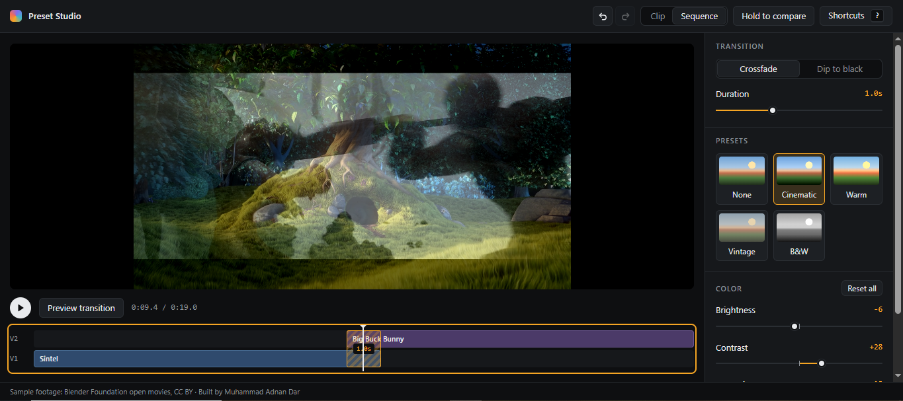

# Preset Studio

**A browser-based mini video editor focused on the "polish" layer of editing: live color grading, one-click looks, transitions, NLE-style keyboard shortcuts, and undo/redo.**

**▶ Live demo: [preset-studio.vercel.app](https://preset-studio.vercel.app)** · Chrome / Edge recommended · no sign-up, nothing uploaded



> **Try it in 30 seconds:** click **Cinematic**, hold **C** to compare with the original, switch to **Sequence** and press **Preview transition**, then press **?** and import your **Premiere Pro** or **Final Cut Pro** layout. **Ctrl+Z** undoes any of it.

---

## Features

| | |
|---|---|
| **Live color grading** | Brightness, contrast, saturation and warmth, applied to playing video in real time. Double-click a slider to reset it; hold **C** (or the button) to compare with the original. |
| **One-click presets** | Cinematic, Warm, Vintage and B&W. The sliders *glide* to the preset's values (280 ms ease-out), so you can see how the look is built. Each preset button previews its own look. Respects `prefers-reduced-motion`. |
| **Transitions** | A two-clip sequence on a V1/V2 timeline. Crossfade or dip to black, 0–3 s (0 = hard cut). The overlap is drawn on the timeline and resizes live. Click or drag to scrub. **Preview transition** jumps to 1.5 s before the cut and plays it. |
| **Keyboard shortcuts** | 20 actions: J/K/L, frame stepping, jumping between edit points, apply transition, view switching and more. **Import a Premiere Pro or Final Cut Pro layout in one click**, then rebind anything by clicking it and pressing keys. Saved in the browser. |
| **Undo / redo** | Covers grades, presets and transitions. A full slider drag is **one** undo step. The buttons say what they'll undo ("Undo Brightness (Ctrl+Z)"). |

## Product decisions

These are the parts I think matter most, because they show up as feel rather than as features.

- **Importing a layout maps intent, not keys.** Premiere's "Apply Video Transition" (Ctrl+D) and Final Cut's "Add Cross Dissolve" (⌘T) both map to this app's *Apply default transition*. Actions with no equivalent keep their defaults, and the panel highlights exactly which rows changed.
- **The browser is a constraint, not an excuse.** Ctrl/⌘ + T, W, N and 1–9 can't be captured by a web page. When you import Final Cut Pro, those three shortcuts are kept as they are and the panel explains why. If you try to bind one by hand, the panel refuses it with a message instead of failing silently.
- **Shortcuts use physical key positions** (`KeyboardEvent.code`), so a layout behaves the same on QWERTY, AZERTY and QWERTZ keyboards. "Mod" means ⌘ on macOS and Ctrl elsewhere, so one layout definition works on both.
- **Some things are not undoable, on purpose.** Switching views, moving the playhead and changing shortcuts are not edits, matching how NLEs behave. Undoing while a preset is still animating returns to the grade from before the preset, not to a half-finished frame.
- **Keys never fight the UI.** A focused slider keeps its own arrow keys. Space on a focused button doesn't trigger it as well as playback. Shortcuts pause while the shortcut editor is open. Holding a key and then switching windows can't leave "compare" stuck on.
- **Every shortcut confirms itself** with a brief on-screen hint ("Ctrl Z · Undo · Cinematic preset"), the way an editor's HUD does, so a keyboard user always knows what just happened.

## How it works

**Color grading in one GPU pass.** Each adjustment is a 5×5 color matrix on `[R, G, B, A, 1]`. The four matrices are multiplied into one and applied through a single SVG `feColorMatrix` filter, so the grade costs the same no matter how many adjustments are active. Saturation uses Rec. 709 luma weights, so B&W is perceptually correct rather than a plain average. ([`src/lib/colorMatrix.ts`](src/lib/colorMatrix.ts))

**Sequence playback with a master clock.** Two stacked `<video>` elements are driven by one `requestAnimationFrame` clock that owns the timeline time. Each video is corrected only when it drifts more than 250 ms during playback, or snapped to the exact frame when paused, so playback stays smooth without the two clips drifting apart. Layer opacity comes from pure timing functions. The grade is applied once to the composited result, like an adjustment layer. ([`src/components/SequenceViewer.tsx`](src/components/SequenceViewer.tsx), [`src/lib/transition.ts`](src/lib/transition.ts))

**One keyboard listener.** A single `keydown`/`keyup` listener reads the latest bindings and handlers through refs, so rebinding a key never re-registers listeners. The players expose a small `PlayerHandle` (play, seek, step frames, jump to edits) via `useImperativeHandle`, so shortcuts don't need to know which player is on screen. ([`src/hooks/useShortcuts.ts`](src/hooks/useShortcuts.ts), [`src/lib/shortcuts.ts`](src/lib/shortcuts.ts))

**Snapshot undo with coalescing.** The history stores what the document looked like *before* each change. Edits with the same key that arrive within 800 ms merge into one entry, so a whole slider drag becomes one undo step. Snapshots fit here because the document is tiny. A larger editor would record commands to reverse instead. ([`src/lib/history.ts`](src/lib/history.ts))

The logic lives in `src/lib` as pure functions with no React, which keeps it easy to test and reason about. Components stay thin.

## Stack

React 19 · TypeScript (strict) · Vite · Oxlint · plain CSS with design tokens · deployed on Vercel. No UI or state libraries.

```
src/
├── App.tsx                 state, history, shortcut wiring
├── lib/                    pure logic: colorMatrix, presets, transition, shortcuts, history
├── hooks/useShortcuts.ts   the global key listener
└── components/             Viewer, SequenceViewer, Timeline, panels, ShortcutsPanel
```

## Run locally

```bash
npm install
npm run dev      # http://localhost:5173
npm run build    # type-check + production build
```

## Limitations

- Built for desktop Chrome and Edge. Safari's support for SVG filters on video is inconsistent.
- J/L step and play forward rather than shuttle at variable speed, because browsers can't reliably play video in reverse.
- Two fixed clips in the sequence. Opening a local file works in Clip view, and the file never leaves the browser.

---

Sample footage: *Sintel* and *Big Buck Bunny* © Blender Foundation, [CC BY](https://creativecommons.org/licenses/by/3.0/).
Built by **Muhammad Adnan Dar** · [GitHub](https://github.com/Dar066)
